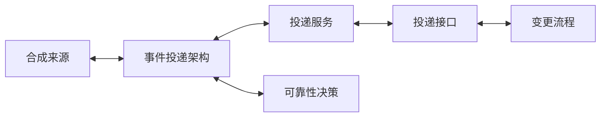

# 工程知识库模板

一个可从零开始的、以 Git 和标准 Markdown 为核心的工程知识库模板。它适合记录架构、服务、接口、领域概念、流程、运维经验和决策。

本模板不包含真实人员、组织、项目、域名、仓库地址、账号、密钥或业务数据。复制后可直接替换示例名称并开始使用。

它不是空目录：仓库内附带一组完全合成的“事件投递”示例，用来演示来源、架构、服务、接口、流程和决策如何通过普通 Markdown 的双向链接组成可维护知识网络。

## 设计目标

- **不强依赖编辑器**：任何 Markdown 编辑器、Git 平台或 Agent 都可使用；Obsidian 只是可选的阅读器。
- **索引优先**：从 [`index/topic-map.md`](index/topic-map.md) 定位主题，再阅读权威笔记和来源记录。
- **证据可追溯**：每项工程事实应关联来源记录；推测与待验证信息显式标记。
- **隐私默认安全**：机密原始资料放在受控系统，不提交到仓库；公开或共享前运行检查。
- **面向 Agent**：`AGENTS.md` 和 `.agents/skills/` 提供可复用的查询、写入、导入、沉淀、检查和治理流程。

## 五分钟开始

1. 复制本目录到新的 Git 仓库，并将 `kb.config.yaml` 中的示例名称换成你的知识库名称。
2. 阅读 [`docs/BOOTSTRAP.md`](docs/BOOTSTRAP.md)、[`AGENTS.md`](AGENTS.md) 和 [`docs/PRIVACY.md`](docs/PRIVACY.md)。
3. 为已有材料创建 [`sources/`](sources/) 下的来源记录，再以 [`_templates/knowledge-note.md`](_templates/knowledge-note.md) 创建笔记。
4. 更新 [`index/topic-map.md`](index/topic-map.md)，使读者和 Agent 能从索引发现新内容。
5. 运行检查：

   ```bash
   python3 .agents/skills/knowledge-lint/scripts/check_knowledge_base.py --root .
   ```

## 先看一个可工作的实例

从 [`index/relationship-map.md`](index/relationship-map.md) 开始浏览。该页展示以下合成笔记之间的双向关系：



每一条双向边都由两篇笔记各自的“关联内容”或“派生笔记”章节维护；检查器会对两篇权威工程笔记之间缺失的反向链接发出警告。详见 [`docs/LINKING.md`](docs/LINKING.md) 和 [`docs/MAINTENANCE.md`](docs/MAINTENANCE.md)。

## 目录

| 路径 | 用途 |
| --- | --- |
| `index/` | 全局主题地图、导航与内容所有权 |
| `architecture/` | 系统边界、数据流、技术选型与生命周期 |
| `services/` | 服务职责、入口、接口与依赖 |
| `modules/` | 业务或产品模块的实现说明 |
| `concepts/` | 领域概念、术语和状态定义 |
| `interfaces/` | API、事件、数据契约和兼容性规则 |
| `workflows/` | 研发、发布、运维与排障流程 |
| `operations/` | 运维手册、风险与恢复步骤 |
| `decisions/` | 可追溯的架构与工程决策记录（ADR） |
| `sources/` | 可公开共享的来源记录和摘要，不存放机密原文 |
| `qa/` | 查询、分析和待办的短期记录 |
| `_templates/` | 新建内容时复制使用的模板 |
| `.agents/skills/` | 给 Codex 或兼容 Agent 使用的工作流 Skill |
| `docs/` | 内容模型、隐私规则、依赖、双向关联和协作规范 |

## Skill 一览

- [`knowledge-query`](.agents/skills/knowledge-query/SKILL.md)：检索知识并报告证据、推断和缺口。
- [`knowledge-add-note`](.agents/skills/knowledge-add-note/SKILL.md)：按模板新增或更新一篇权威笔记。
- [`knowledge-ingest`](.agents/skills/knowledge-ingest/SKILL.md)：把原始材料编译成来源记录和多篇关联笔记。
- [`knowledge-digest`](.agents/skills/knowledge-digest/SKILL.md)：将一次任务或讨论提炼为可复用知识。
- [`knowledge-lint`](.agents/skills/knowledge-lint/SKILL.md)：只读检查结构、元数据、链接和明显隐私风险。
- [`knowledge-governance`](.agents/skills/knowledge-governance/SKILL.md)：管理内容归属、复审、保留与共享边界。

## 不做什么

- 不把原始私密资料、访问凭据或生产数据提交到 Git。
- 不把没有来源的猜测写成工程事实。
- 不要求 Obsidian、数据库、向量检索服务、云存储或特定厂商 API。

详见 [`docs/DEPENDENCIES.md`](docs/DEPENDENCIES.md) 和 [`docs/CONTENT-MODEL.md`](docs/CONTENT-MODEL.md)。
