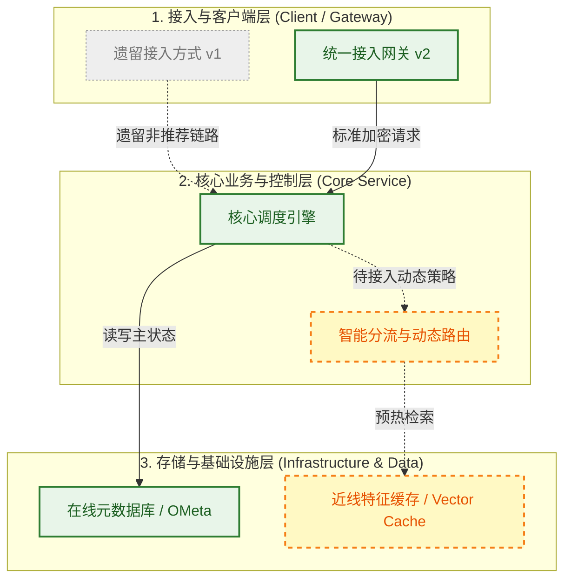

<!-- 一句话摘要：说明本系统/方案的核心目标、解决的业务痛点及当前演进阶段 -->
<!-- 将本页保存为 architecture/<scope>/<page>.md，并同步更新 scope README 与全局 _index/topic-map.md -->

## 一、 架构与流程全景图

> [!abstract] 视觉与状态规范
> - **人类快速感知通道**：本图必须保持全貌完整性。读者仅需阅读此图，即可全面掌握系统模块边界、数据流向及落地进展。
> - **实线与实线框（已实现）**：表示已上线、稳定运行的模块与已打通的数据流（绿色/标准高亮边框）。
> - **虚线与虚线框（设计中/规划中）**：表示目标态、正在设计或待建设的模块与链路（黄色/蓝色虚线边框 `stroke-dasharray: 5 5`）。
> - **灰色与中划线（已废弃）**：表示已弃用、计划下线或遗留兼容链路（灰度边框与文字）。
> - **模块色块（Subgraph）**：通过不同模块分组或节点类名区分业务域（如接入层、核心服务、存储层、下游依赖）。

---

## 二、 能力演进矩阵与子文档路由

> [!summary] 概要与子文档导航
> 本表清晰梳理各版本能力演进与边界对比，作为人类快速检索和功能下钻的路由中心。若某能力项有专项设计，直接在最后一列挂载对应子文档或锚点。

| 能力 / 功能项 | 遗留版本 (v1) | 当前版本 (v2) | 目标版本 (v3) | 能力说明与演进差异 | 关联子文档 / 锚点 |
| :--- | :---: | :---: | :---: | :--- | :--- |
| **<核心能力 A>** | ❌ 无 | ✅ 基础支持 | ✅ 完整高可用 | 说明当前版本的实现程度，以及目标版本做了哪些扩展。 | [[子文档A相对路径]] 或 [[#3.1 核心协议与数据流]] |
| **<核心能力 B>** | ❌ | 🚧 建设中 | ✅ | 说明演进诉求、关键瓶颈与推进计划。 | [[子文档B相对路径]] |
| **<优化特性 C>** | ✅ 简单轮询 | ✅ 权重配置 | ⏳ 动态时延感知 | 对比不同版本在该能力上的算法或架构演进。 | [[#3.2 关键算法与分支推演]] |
| **<老功能兼容 D>** | ✅ | ⚠️ 标记废弃 | ❌ 彻底下线 | 说明平滑迁移方案与计划下线时间表。 | [[下线与迁移专项文档]] |

> **状态标识说明**：`✅ 完整支持` ｜ `🚧 灰度/建设中` ｜ `⏳ 规划中` ｜ `⚠️ 计划废弃` ｜ `❌ 不支持`

---

## 三、 技术规格与实现细节

> [!note] 深度细节说明
> 前两部分为高维摘要。本节为特定方案的完整技术实现细节，主要供深度架构评审、落地开发与 AI Agent 精确理解上下文。

### 3.1 核心协议与数据流
<!-- 详细请求/响应参数、IDL/Struct 结构体定义、状态机流转与变更时序图 -->

### 3.2 关键算法与分支推演
<!-- 核心分支逻辑、伪代码、并发并发控制与锁策略、缓存更新策略 -->

### 3.3 异常边界、容灾与降级策略
| 故障场景 | 影响范围 | 自动容灾/降级行为 | 报警指标与人工恢复步骤 |
| :--- | :--- | :--- | :--- |
| 上游服务超时 (>2s) | 单次请求失败 | 触发重试备选通道，降级返回保底缓存 | `service.upstream.timeout.count` |
| 存储写入异常 | 状态暂未落库 | 异步重试队列缓冲，避免阻塞主流程 | `storage.write.retry.qps` |

### 3.4 未验证项与遗留债务
<!-- 记录尚未通过压测验证的边界、技术债或待后续专项解决的问题 -->
- [ ] 
