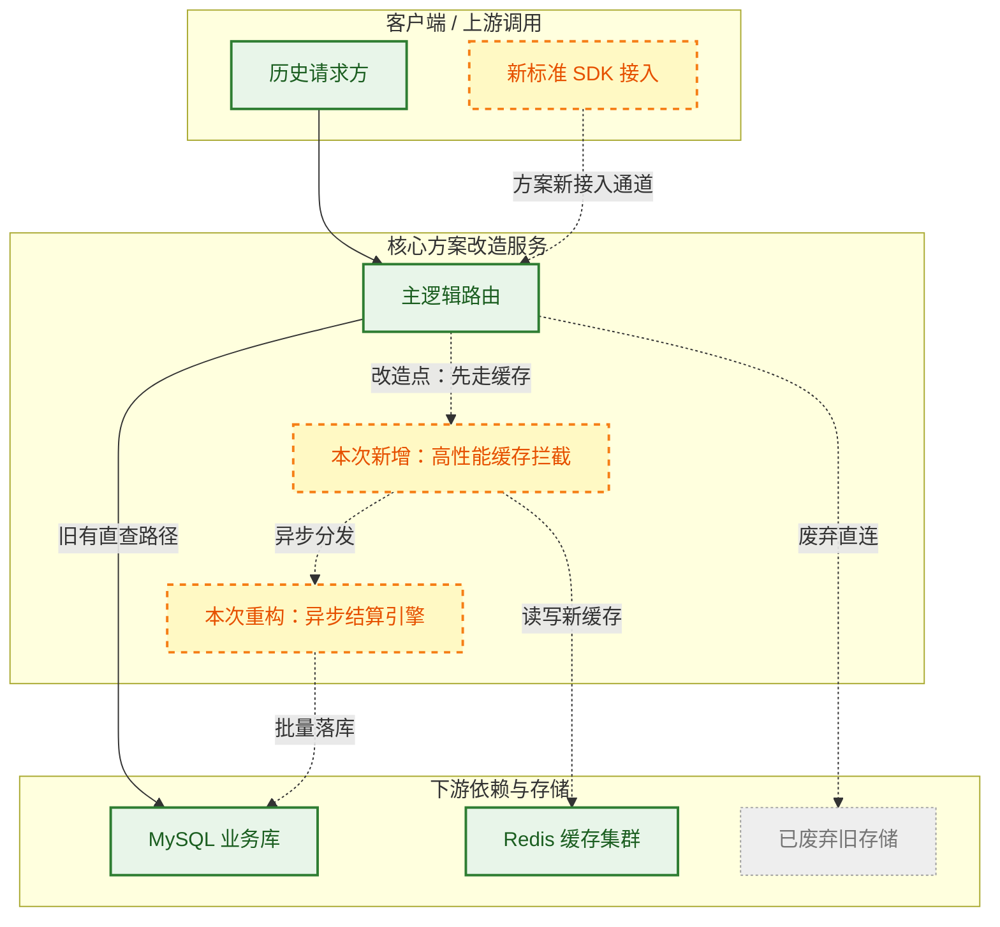

<!-- 一句话摘要：说明本专项/方案的核心目标、解决的业务痛点及当前所处阶段 -->
<!-- 本文件保存为 initiatives/<name>/README.md，是专项目标、方案、状态和本地索引的事实源 -->

## 一、 方案架构与推进全景图

> [!abstract] 视觉与状态规范
> - **人类快速感知通道**：保持方案全局完整性。读者仅看本图，即可获知方案核心逻辑、涉及系统及当前推进现状。
> - **实线与实线框（已完成/现有基线）**：表示现有线上稳定系统，或本次方案中已交付通过的链路（绿色高亮边框）。
> - **虚线与虚线框（设计中/进行中）**：表示本次专项的核心改造点、新增设计或正在实施的链路（黄色/橙色虚线边框 `stroke-dasharray: 5 5`）。
> - **灰色与中划线（废弃/不在范围内）**：表示明确不在本次专项范围（Out-of-scope）或计划下线替换的模块。
> - **模块色块（Subgraph）**：按业务模块或系统边界划分色块。

---

## 二、 专项能力对比与子文档路由

> [!summary] 目标对比与子文档导航
> 本表对比方案实施前后的能力变化，并作为整个专项子文档（需求、调研、详细设计、交付验收）的路由中心。

| 核心改动 / 能力项 | 现状 (专项前) | 目标态 (专项后) | 当前进度 | 方案说明与收益 | 专项子文档 / 锚点 |
| :--- | :--- | :--- | :---: | :--- | :--- |
| **<核心改动点 A>** | 每次请求实时查库，延迟 80ms | 引入多级缓存，P99 降低至 10ms | 🚧 开发中 | 消除大促高峰数据库读瓶颈 | [[design/cache-architecture]] |
| **<功能增强 B>** | 手工脚本处理，耗时 30min | 自动化任务流，秒级响应 | ⏳ 待启动 | 全链路自动化改造 | [[requirements/automation-spec]] |
| **<架构重构 C>** | 单体串行调用 | 异步消息解耦，支持水平扩展 | ✅ 已完成 | 提升系统吞吐量 5 倍以上 | [[#3.1 核心设计与数据流]] |
| **<遗留下线 D>** | 维护双读老逻辑 | 彻底清理下线老接口 | ⏳ 规划中 | 消除历史技术债 | [[delivery/deprecation-checklist]] |

> **状态标识**：`✅ 已交付` ｜ `🚧 进行中` ｜ `⏳ 待排期` ｜ `⚠️ 阻塞/风险` ｜ `❌ 已取消`

---

## 三、 方案实施与技术规格细节

> [!note] 深度细节说明
> 前两部分为高维摘要。本节为方案的具体技术规格、数据契约与交付计划，供技术评审与 AI Agent 精准执行。

### 3.1 核心数据流与接口协议
<!-- 详细请求/响应契约、DB 表结构变更（DDL）、IDL 变更、时序图 -->

### 3.2 关键算法与分支推演
<!-- 核心逻辑伪代码、重试与幂等机制、并发控制与锁设计 -->

### 3.3 专项里程碑与交付计划
| 阶段 | 目标与交付物 | 计划完成时间 | 责任人 / 状态 |
| :--- | :--- | :--- | :--- |
| 阶段一 | 完成技术方案评审与 DDL 变更 | YYYY-MM-DD | `✅ 已完成` |
| 阶段二 | 核心逻辑编码与单元测试覆盖率 >80% | YYYY-MM-DD | `🚧 进行中` |
| 阶段三 | 压测通过，灰度放量 10% -> 100% | YYYY-MM-DD | `⏳ 未开始` |

### 3.4 灰度放量、容灾与回滚预案
| 风险场景 | 判定条件 / 监控指标 | 应急与回滚动作 |
| :--- | :--- | :--- |
| 新逻辑报错率 > 0.5% | `app.service.error.rate > 0.005` | 一键关闭配置开关，流量无缝回切老链路 |
| 缓存穿透引起 DB 负载激增 | `db.cpu.utilization > 80%` | 开启保底静态兜底，临时限流非核心流量 |

### 3.5 稳定知识沉淀去向
<!-- 专项完成后，需将沉淀的长期价值知识更新至长期目录，在此登记映射 -->
- [ ] 系统架构更新 -> `[[architecture/...]]`
- [ ] 对外服务接口更新 -> `[[services/...]]`
- [ ] 运维排障 SOP -> `[[workflows/...]]`
