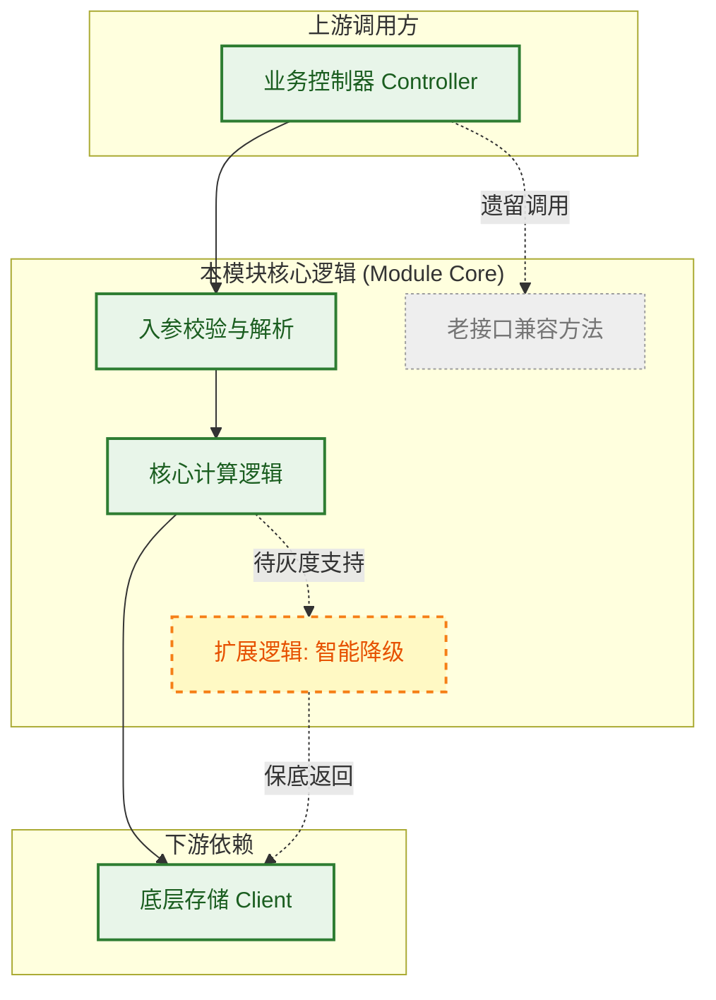

<!-- 一句话摘要：说明该模块的核心职责、定位与适用边界 -->
<!-- 本文件保存为 modules/<component>.md，并在全局 _index/topic-map.md 中注册 -->

## 一、 模块调用与逻辑全景图

> [!abstract] 视觉与状态规范
> - **人类快速感知通道**：展示模块内部核心状态流转，或本模块与上下游组件的调用拓扑。
> - **实线与实线框（已支持能力）**：已实现、稳定提供的核心方法/函数/逻辑链路（绿色边框）。
> - **虚线与虚线框（规划中/待扩展能力）**：正在设计、计划新增的方法或调用分支（黄色/橙色虚线边框 `stroke-dasharray: 5 5`）。
> - **灰色与中划线（已废弃接口）**：标记为 Deprecated、计划下线的方法。

---

## 二、 模块能力矩阵与接口子文档路由

> [!summary] 方法能力与代码入口导航
> 清晰盘点本模块对外提供的能力、版本差异及对应代码/子文档入口。

| 对外方法 / 能力项 | 支持版本 | 状态 | 输入输出契约简述 | 关联代码路径 / 子文档 |
| :--- | :---: | :---: | :--- | :--- |
| **`ExecuteTask(ctx, req)`** | v2.0+ | ✅ 稳定 | 标准批处理任务调度入口，返回 TaskID | `src/core/task.go` 或 [[#3.1 接口协议与输入输出]] |
| **`StreamProcess(ctx, ch)`** | v2.2+ | 🚧 灰度中 | 基于 Channel 的实时流式处理方法 | `src/core/stream.go` |
| **`LegacyRun(cmd)`** | v1.0 | ⚠️ 废弃 | 遗留同步执行方法，将在下个小版本移除 | [[#3.3 废弃接口下线指南]] |

> **状态标识**：`✅ 稳定` ｜ `🚧 灰度中` ｜ `⏳ 规划中` ｜ `⚠️ 废弃警告` ｜ `❌ 不支持`

---

## 三、 模块实现细节与并发控制

> [!note] 深度实现说明
> 包含模块核心类设计、并发安全性、缓存逻辑与异常边界处理。

### 3.1 核心接口契约与数据结构
<!-- 核心 Struct、Interface 声明，字段取值范围与限制 -->

### 3.2 并发模型、锁策略与状态机
<!-- 线程/协程模型、读写锁使用场景、状态变更约束 -->

### 3.3 依赖约束与排障边界
| 依赖组件 | 强弱依赖 | 依赖异常时的表现 | 排障日志关键字与 Metric |
| :--- | :--- | :--- | :--- |
| 外部 Redis 缓存 | 弱依赖 | 自动降级击穿查库，不影响主流程 | `redis.client.error` |
| 底层 RPC 服务 | 强依赖 | 快速失败并抛出 5003 错误 | `downstream.rpc.fail` |

### 3.4 遗留债务与优化计划
- [ ] 优化核心锁粒度，减少高并发读等待
