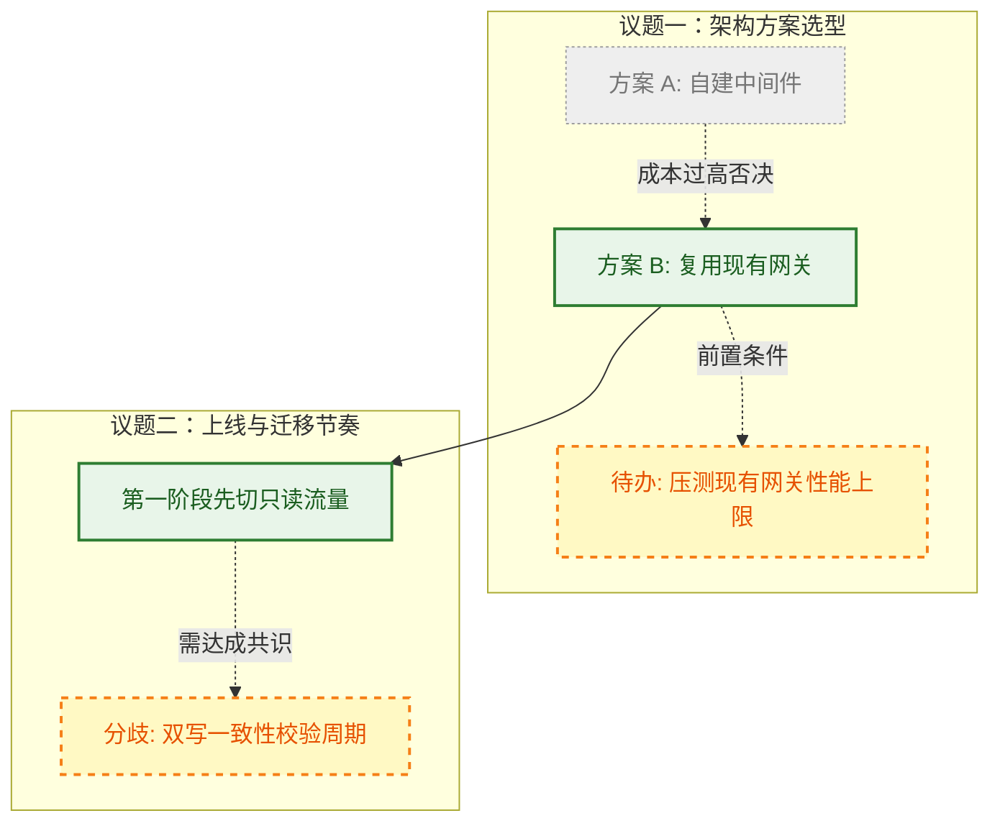

<!-- 一句话摘要：说明该原始材料的核心议题、发起背景与主要产出 -->
<!-- 本文件保存在 raw/ 目录下，作为原始事实源依据。保持客观保真，不静默修改原始内容 -->

## 一、 原始讨论与事实脉络全景图

> [!abstract] 视觉与结论规范
> - **人类快速感知通道**：用一张图提取原始材料中的核心逻辑、关键决策与争议分歧。
> - **实线框与实线（已达成共识 / 已明确事实）**：代表讨论中各方一致确认的结论、已落地现状（绿色边框）。
> - **虚线框与虚线（待办 Action Items / 待确认分歧）**：代表会议后续待办、未决争议点或待调研事项（黄色/橙色虚线边框 `stroke-dasharray: 5 5`）。
> - **灰色与中划线（已否决备选方案）**：代表讨论中提出但最终被团队放弃的备选方案。

---

## 二、 核心信息提取与编译路由表

> [!summary] 关键结论提取与知识库路由
> 提取原文核心结论，并建立指向编译后长期知识库页面的子文档路由。

| 议题 / 关键事实点 | 讨论结论 / 核心共识 | 决策依据 / 争议要点 | 编译沉淀到知识库的子文档 |
| :--- | :--- | :--- | :--- |
| **<核心议题 1>** | 采用方案 B 落地 | 现有网关运维成熟，减少研发成本 | [[architecture/scope/gateway-design]] |
| **<待办事项 2>** | 下周三前完成压测 | 摸清峰值 QPS 下的延迟水线 | [[initiatives/perf-benchmark/README]] |
| **<规范约定 3>** | 统一使用 v2 错误码标准 | 解决多端报错文案不一致问题 | [[concepts/error-codes]] |

---

## 三、 原始材料保真全文

> [!note] 原文保真存档
> 以下为经脱敏后的会议逐字稿、飞书原文或代码分析日志全文，供事实核验与 AI 深度上下文分析。

### 3.1 基础元信息
- **记录人 / 参与人**：
- **会议 / 产出时间**：
- **关联需求 / 任务 ID**：

### 3.2 原始内容记录
<!-- 在此粘贴未经失真修改的原始正文内容 -->

