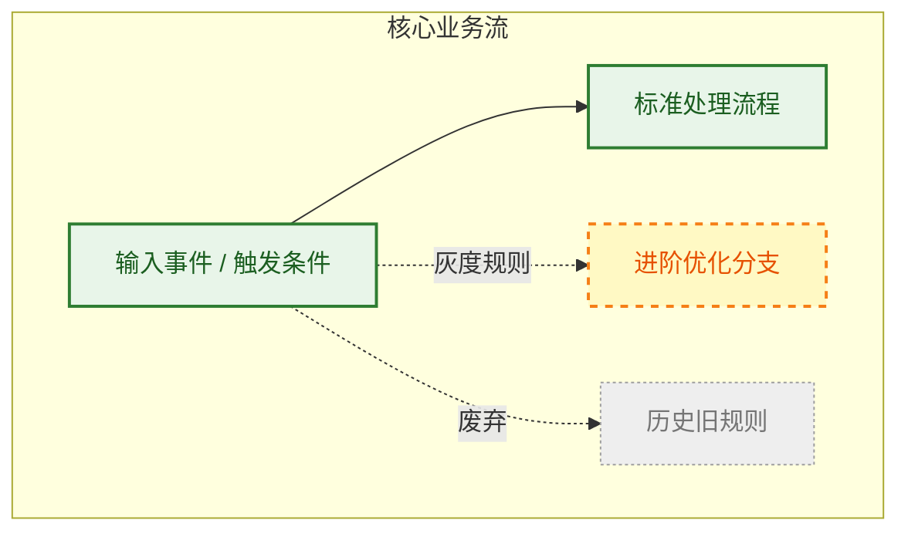

<!-- 一句话摘要：说明本页面要回答的核心问题、适用范围与主要结论 -->
<!-- 本文件在全局 _index/topic-map.md 中注册，并链接到对应领域的本地导航 -->

## 一、 核心逻辑与业务全景图

> [!abstract] 视觉与状态规范
> - **人类快速感知通道**：通过全局图呈现本知识主题的核心脉络与处理流程。
> - **实线（已验证事实 / 稳定链路）**：当前客观成立的业务逻辑、规范或技术链路（绿色高亮）。
> - **虚线（待验证主张 / 演进中）**：尚未完全压测验证、实验中或计划演进的逻辑分支（黄色/橙色虚线）。
> - **灰色（已过时废弃）**：历史旧规范、已废弃规则或弃用分支。

---

## 二、 核心结论矩阵与子文档路由

> [!summary] 关键结论与子文档导航
> 本表提炼该主题下的关键判断与边界，并提供进一步深入查阅的子文档链接。

| 核心结论 / 规则项 | 适用场景 / 约束边界 | 验证依据 / 来源 | 状态 | 深入查阅 / 子文档 |
| :--- | :--- | :--- | :---: | :--- |
| **<核心结论 A>** | 适用于高并发写入场景 | 压测数据与源码分析 | ✅ 已验证 | [[子文档A相对路径]] 或 [[#3.1 详细设计说明]] |
| **<业务规则 B>** | 仅在白名单租户下生效 | 业务契约配置 | 🚧 实验中 | [[专项方案文档]] |
| **<排障经验 C>** | 处理 GC 频繁报警 | 线上历史故障复盘 | ✅ 稳定 | [[#3.3 排障手册与常见问题]] |

---

## 三、 深度细节与事实证据

> [!note] 事实证据与推演细节
> 本节记录详细的技术说明、推演过程、代码/配置入口以及未验证项，供 AI 与资深开发者深入核查。

### 3.1 详细技术说明与代码入口
- **代码 / 配置路径**：
- **核心数据结构**：
- **推演过程与边界**：

### 3.2 事实源与参考依据
| 证据类型 | 链接或路径 | 说明 |
| :--- | :--- | :--- |
| 生产代码 / 配置 | | |
| Raw 原始快照 | | |
| 外部来源 / 飞书文档 | | |

### 3.3 未验证项与遗留债务
<!-- 列出尚未充分压测验证、待补充证据或有争议的技术点 -->
- [ ] 
