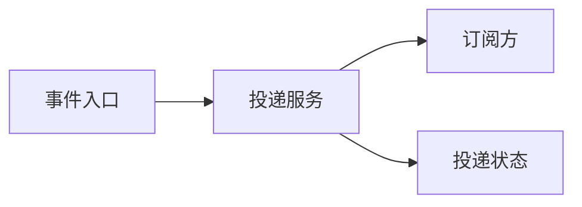

# 示例事件投递架构

> 本文是完全合成的示例，用于演示知识库的写法与双向关联，不描述真实系统。

## 范围

说明一个从“接收事件”到“异步投递”的最小系统边界，不定义任何真实业务协议。

## 已验证事实

- 事件入口只接受结构化请求，并把投递工作交给异步服务。
- 投递结果由服务写为 `accepted`、`delivered` 或 `needs-review` 三种合成状态。

## 设计或行为

## 来源

- [SRC-0001 合成设计来源](../sources/SRC-0001-synthetic-design.md)

## 相关内容

- [SRV-0001 示例投递服务](../services/SRV-0001-example-delivery-service.md)
- [DEC-0001 可靠性决策](../decisions/DEC-0001-example-reliability-decision.md)
- [示例关系地图](../index/relationship-map.md)
