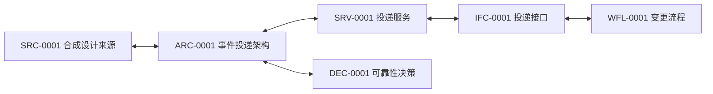

# 示例关系地图

> 本页全部内容均为合成示例，不描述任何真实系统。它展示标准 Markdown 如何实现可迁移的双向 Wiki 关系。

| 关系 | 一端 | 另一端 | 维护位置 |
| --- | --- | --- | --- |
| 来源依据 | [SRC-0001](../sources/SRC-0001-synthetic-design.md) | [ARC-0001](../architecture/ARC-0001-example-event-delivery.md) | 来源的“派生笔记”与架构的“来源” |
| 服务属于架构 | [ARC-0001](../architecture/ARC-0001-example-event-delivery.md) | [SRV-0001](../services/SRV-0001-example-delivery-service.md) | 两篇笔记的“相关内容” |
| 服务实现接口 | [SRV-0001](../services/SRV-0001-example-delivery-service.md) | [IFC-0001](../interfaces/IFC-0001-example-delivery-contract.md) | 两篇笔记的“相关内容” |
| 流程调用接口 | [IFC-0001](../interfaces/IFC-0001-example-delivery-contract.md) | [WFL-0001](../workflows/WFL-0001-example-change-flow.md) | 两篇笔记的“相关内容” |
| 决策影响架构 | [ARC-0001](../architecture/ARC-0001-example-event-delivery.md) | [DEC-0001](../decisions/DEC-0001-example-reliability-decision.md) | 两篇笔记的“相关内容” |

阅读顺序：先看 [SRC-0001](../sources/SRC-0001-synthetic-design.md)，再进入 [ARC-0001](../architecture/ARC-0001-example-event-delivery.md)，并沿着每篇笔记底部的链接来回跳转。
